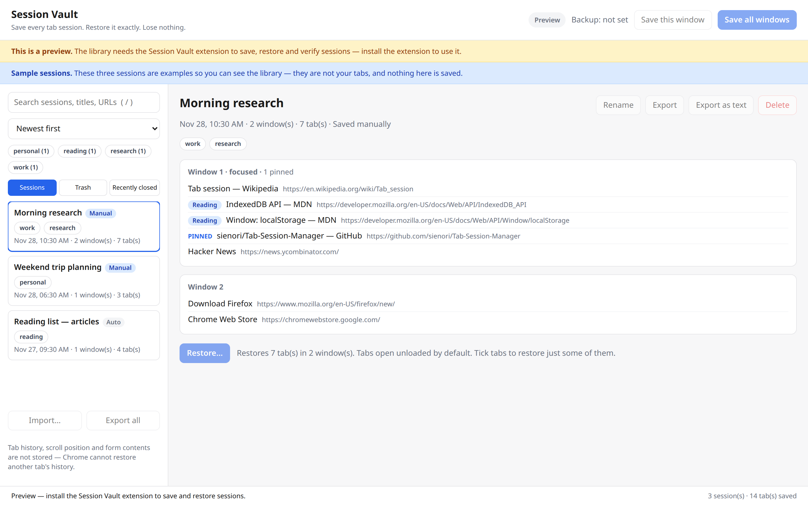
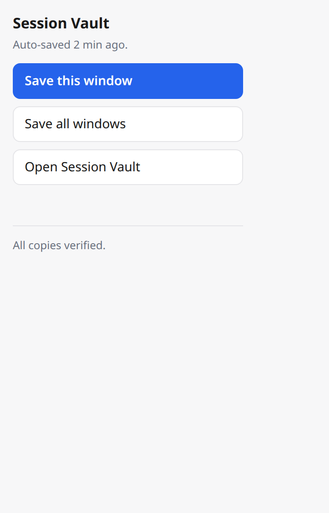

# Session Vault

Save every tab session. Restore it exactly. Lose nothing.

> A browser extension (Chrome / Edge, Manifest V3) that saves whole browsing sessions — every window, every tab, every tab group — and restores them exactly, with an auto-save that runs on every tab change and a crash-recovery banner on the next browser start.



*The session library, with sample sessions. Try it live — no install needed — at https://eslam-tohamy2026.github.io/session-vault/manager/index.html*



*The toolbar popup: two one-click saves and the last auto-save time.*

## Why another session manager?

Session Buddy (~1M users), Tab Session Manager (~100K on Chrome, ~175K on Firefox) and Workona are the names that come up in every roundup — and their users keep reporting the same failures: saved sessions vanish after an update or a crash, auto-save quietly stops, restores lose tab groups, and nothing is captured when the browser crashes. Session Buddy's own maker says its automatic local backups can lag recent changes by up to 24 hours. Tab Session Manager's users report the same vanishing sessions, and its GitHub page carries hundreds of issues with no reply. Workona solves the backup problem by keeping everything in the cloud — which means an account, your tabs on someone else's servers, and a free plan capped at 5 workspaces (Pro from $6/month).

Session Vault is built around a guarantee, engineered rather than claimed:

- **Three independent copies of every session.** (1) IndexedDB is the primary store. (2) A rotating pair of slots in `chrome.storage.local` mirrors the latest auto-save, each with a SHA-256 checksum — a torn write can only ever damage the slot being written. (3) A dated JSON file in a folder *you* choose, outside the browser profile, written through the File System Access API — it survives a wiped profile, a wiped browser, or an uninstalled extension.
- **Verified on every start.** The mirror is checksum-verified on browser start and on every manager-page open. If a copy is damaged, the extension heals itself from the next good copy and tells you plainly — it never silently opens to an empty list. A healed mirror keeps the known-good copy as its backup; a damaged slot is never parked as the fallback.
- **Auto-save that actually runs.** Every tab, window and group change marks the live snapshot dirty (2 s debounce); a 5-minute alarm backstop re-captures anything a missed event or a killed service worker left behind. The daily file backup is written whenever *anything* changed — a manual save counts, not just the live snapshot.
- **Restore that respects the original.** A whole session, one window, or just the tabs you tick; into a new window or the current one; open one tab on its own from the detail view. Tabs open **unloaded** by default (only the active tab loads), pinned tabs stay pinned, groups come back with their title, colour and collapsed state. Tabs already open are skipped by default, with a count; tabs that cannot be opened (`chrome://` pages, `file://` without the toggle) are listed with the reason — a restore is never reported as complete when it was not.
- **A library you can actually find things in.** Tags on sessions with one-click filtering, sorting (newest, oldest, name, most tabs), and search across session names, tags, tab titles and URLs — the whole session, not just its first ten tabs.
- **Free forever.** No account, no sync, no server, no paid tier.

### How it compares (November 2026)

Figures are from the extensions' own listings and independent review roundups read in November 2026; ratings move over time, so treat them as a snapshot, not a verdict.

|  | Session Vault 2.0 | Session Buddy 4.1.2 | Tab Session Manager 7.4 | Workona |
|---|---|---|---|---|
| Price | Free, no paid tier | Free, no paid tier | Free, no paid tier | Free (5 workspaces max); Pro from $6/mo |
| Account / cloud | None — local only | None — local only (opt-in paid cloud planned) | None unless you turn on Google Drive sync | Account required; tabs sync to Workona's servers |
| Copies of your sessions | 3, checksum-verified, one outside the browser | 1 in the browser + local backups (may lag up to 24h) | 1 in the browser + optional Drive sync | Cloud |
| Auto-save | On every tab change + 5-min backstop | Timeline of past states; saves mostly manual | Timer (15 min default), on window close, on exit | Continuous, to the cloud |
| Tab groups preserved | Yes — title, colour, collapsed | No | Yes, but users report names lost on restore | Workspaces, not Chrome tab groups |
| Restore granularity | Session, window, selected tabs, single tab | Session, window, current window | Session, window, current window | Workspace |
| Tags / collections | Tags + filter | Bookmark collections | Tags | Spaces |
| Cross-browser | Chrome / Edge | Chrome only | Chrome / Firefox / Edge | Chrome / Edge / Firefox |
| Open source | MIT | No | MPL-2.0 | No |

What Session Vault deliberately does **not** do: cloud sync, team spaces, AI summaries, or tab suspension. Those are real features of the incumbents, and if you need your sessions on two machines today, Tab Session Manager's free Google Drive sync is the honest answer. Session Vault trades them for a smaller promise it can keep: your sessions cannot be lost to a corrupt profile, because a verified copy lives outside it.

## Privacy

Your tabs never leave the device. No server, no account, no tracking, no sync. The only place a session goes outside the browser is a file in a folder *you* chose. The code has no `fetch`, no XHR, no analytics, no third-party script, no host permissions.

**Permissions, each justified:**

| Permission | Why | Install warning |
|---|---|---|
| `tabs` | Read tab URLs/titles; create, move and discard tabs on restore | **"Read your browsing history"** — the one install warning. It is unavoidable and honest: a session manager that cannot read tab URLs cannot save sessions. Every incumbent shows the same warning. |
| `tabGroups` | Read and restore group titles, colours and collapsed state | None |
| `storage` | The local mirror, the session index and settings | None |
| `sessions` | Read Chrome's recently-closed list as a second recovery source | None |
| `alarms` | The 5-minute auto-save backstop and 15-minute file backup | None |
| `unlimitedStorage` | Lifts the 10 MB `storage.local` cap and exempts the extension's IndexedDB from quota eviction | None |

Not requested: `history` (never read), `downloads` (file backup uses the File System Access API instead), `identity` (no sign-in, no cloud), any host permission (never touches page content).

**One honest limitation:** Chrome does not expose window names to extensions, so a saved session cannot restore a window's name — the name field is stored for the future but is empty today. Tab history, scroll position and form contents are likewise not stored (Chrome cannot restore another tab's history). The manager page says this plainly.

## Install (load unpacked)

```bash
git clone https://github.com/eslam-tohamy2026/session-vault.git
cd session-vault
```

1. Open `chrome://extensions` (or `edge://extensions`).
2. Turn on **Developer mode** (top right).
3. Click **Load unpacked** and choose this folder.
4. Click the extension icon in your toolbar — the popup saves a session in one click; **Open Session Vault** opens the library.

No install yet? The library is served as a public preview at https://eslam-tohamy2026.github.io/session-vault/manager/index.html — it shows three sample sessions so you can see the search, sorting, tags and detail view before installing. The samples are clearly labelled and never saved anywhere.

## Use it

- **Save:** click the toolbar icon → *Save this window* or *Save all windows*; or *Save all windows* in the manager. Saved sessions appear in the library with their window/tab counts.
- **Auto-save:** already running. Change a tab and the live snapshot updates within seconds; the popup shows when it last saved.
- **Recover after a crash:** on the next start, an amber banner offers to restore the last auto-saved snapshot, with its time and tab count. The *Recently closed* tab lists what Chrome itself remembers (up to 25 items).
- **Restore:** select a session → *Restore…* → confirm the target window, whether to skip duplicates, and whether tabs open unloaded. Or restore just one window (*Restore this window*), just the tabs you tick (*Restore selected*), or a single tab (*Open* on its row). Every variant shows the same honest preview: how many tabs will open, how many are already open, and which ones cannot be opened and why.
- **Organise:** rename a session and give it tags (comma-separated, in the Rename dialog); click a tag chip to filter the library; sort by newest, oldest, name, or most tabs.
- **Backup folder:** pick a folder once (manager top bar) and a dated `session-vault-YYYY-MM-DD.json` is written there on every manual save and every 15 minutes. Until you pick one, the manager shows a calm reminder — everything else still works.
- **Search:** `/` focuses the search box; it searches session names, tags, tab titles and URLs.
- **Trash:** deleted sessions are kept 30 days and can be restored from the *Trash* tab — or deleted forever from there, and the trash can be emptied in one click.
- **Export:** a session as JSON, or as a plain-text list of links (*Export as text*); all sessions as one JSON file.

## Import

The manager's *Import…* button accepts three formats:

- **Session Vault JSON** — our own versioned export (`{ format: "session-vault", schemaVersion: 1, sessions: [...] }`).
- **OneTab text export** — one tab per line (`url | title`), blank lines separate groups; a non-URL line starting a block becomes that group's title.
- **Tab Session Manager JSON** — its sessions array, with flat `tabs` or `windows` lists; tags are imported where present. Tab-group membership does not survive a TSM import — its export does not carry group titles in a form we can map reliably, so imported tabs arrive ungrouped rather than wrongly grouped.

Re-importing the same file never duplicates sessions, and a foreign file can never silently overwrite a different session that happens to share an id — it is saved under a fresh id instead. A file that fails validation is reported line by line — the good sessions still import, nothing crashes.

## Development

```bash
npm test
```

Runs the Node test suite (38 tests, zero dependencies — plain Node, no install step):

- `tests/test_sessionstore.mjs` (13 tests) — the pure session model: capture, URL normalisation, restore planning, checksums, self-healing, import/export.
- `tests/test_restore.mjs` (8 tests) — the restore engine against a fake Chrome API, including the about:blank discard trap and the v2 window/selected-tab restores.
- `tests/test_manager_preview.mjs` (8 tests) — the manager page in a vm with no `chrome` global: preview mode, sample sessions, disabled actions, dialog button behaviour, the `[hidden]` CSS rule.
- `tests/test_v2.mjs` (9 tests) — the v2 additions: per-window/selected subsets, sorting, backup timing, import de-duplication, tags.

Screenshots in `docs/screenshots/` are real renders of the shipped manager and popup, taken with headless Chromium — see `docs/screenshots/take-screenshots.py`. Re-run it after any UI change and look at the images before committing them.

## File layout

```
manifest.json          Manifest V3, exactly six permissions
background.js          Service worker: auto-save, alarms, integrity, messages
lib/sessionstore.js    Pure session model (UMD — same file runs in Node tests)
lib/idb.js             IndexedDB promise wrapper
lib/backup.js          File System Access backup (pure filename helpers + writes)
lib/restore.js         Restore engine (injected Chrome API — testable in Node)
popup/                 Toolbar popup: two one-click saves
manager/               Session library: list, search, sort, tags, detail, restore, import
docs/screenshots/     Real renders of the manager and popup (headless Chromium)
icons/                 Locally generated icons (16/32/48/128)
tests/                 Node tests, no chrome.* anywhere
```

## License

MIT — see [LICENSE](LICENSE).
